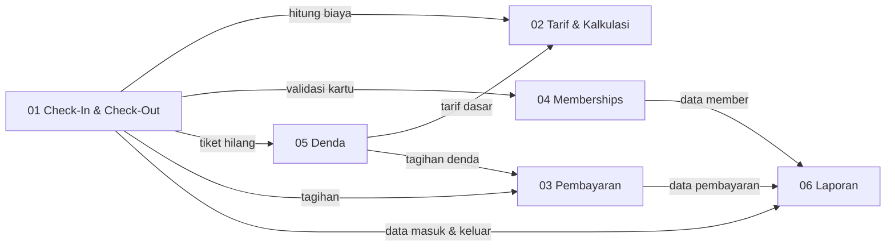

# ParkirPintar Dokumentasi Modul

Dokumen ini memuat daftar modul sistem parkir ParkirPintar. Sistem mencatat kendaraan masuk dan keluar melalui tiket QR atau kartu member, menghitung tarif per jam, memproses pembayaran, dan mengelola keanggotaan. Acuan kebutuhan ada di [D1-problem-statement.md](../D1-problem-statement.md).

## Struktur Folder

```
docs/
├── D1-problem-statement.md
├── D2-Modules/
│   ├── README.md
│   ├── 01-CheckIn-CheckOut.md
│   ├── 02-Tarif-Kalkulasi.md
│   ├── 03-Pembayaran.md
│   ├── 04-Memberships.md
│   ├── 05-Denda.md
│   └── 06-Laporan.md
├── D3-use-case-diagram/
├── D4-sequence-diagram/
└── images/
```

## Daftar Modul

| No | Modul | Berkas | Isi Utama |
|----|-------|--------|-----------|
| 01 | Check-In & Check-Out | [01-CheckIn-CheckOut.md](01-CheckIn-CheckOut.md) | Penerbitan tiket QR saat masuk, pembacaan tiket dan kartu saat keluar |
| 02 | Tarif & Kalkulasi | [02-Tarif-Kalkulasi.md](02-Tarif-Kalkulasi.md) | Perhitungan biaya per jam dengan batas maksimum harian |
| 03 | Pembayaran | [03-Pembayaran.md](03-Pembayaran.md) | Pembayaran tunai dan QRIS, rekonsiliasi setoran operator |
| 04 | Memberships | [04-Memberships.md](04-Memberships.md) | Pendaftaran, perpanjangan, dan penonaktifan kartu member |
| 05 | Denda | [05-Denda.md](05-Denda.md) | Penanganan tiket hilang dan penetapan denda |
| 06 | Laporan | [06-Laporan.md](06-Laporan.md) | Kapasitas real-time, dashboard, dan laporan pendapatan |

## Aturan Lintas Modul

Aturan berikut berlaku untuk seluruh modul dan tidak dibuat sebagai modul tersendiri:

- **Hak akses per peran.** Pengunjung dan member hanya menggunakan tiket atau kartu. Operator memproses transaksi dan shift miliknya. Admin mengatur tarif, member, akun, dan laporan.
- **Satu transaksi aktif per kendaraan.** Angka pada laporan, kapasitas, dan setoran dibaca dari transaksi yang sama.

## Diagram Hubungan Antar Modul



## Ruang Lingkup di Luar Sistem

Pengenalan plat nomor otomatis, pengembangan perangkat keras (palang, mesin tiket, scanner), reservasi slot parkir, integrasi dengan sistem akuntansi atau pajak, dan layanan keamanan kendaraan tidak termasuk dalam dokumentasi modul.
